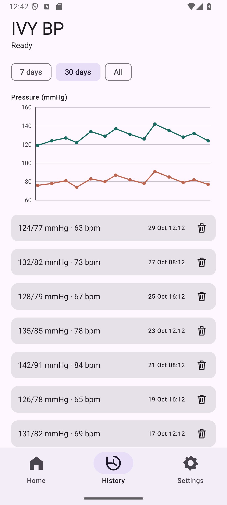

# IVY BP

Android app for syncing IVY Health IVBPW / LS810-B blood-pressure monitors over Bluetooth LE.

## Features

- Blood pressure and heart-rate recording
- Automatic background sync and measurement notifications
- Reading history and charts
- CSV export and JSON backup/restore
- Individual and bulk deletion
- Monitor clock synchronization

## Privacy

**Readings stay on your phone. They are not sent to third-party services, except
through Android system backup when you have it enabled.**

The app has no Internet permission, account, analytics, advertising, or backend.
Android manages system backup and device-to-device transfer. Cloud backup requires
the platform's encryption capabilities.

Exports are written to the destination you choose. A cloud document provider may
upload exported files. Diagnostic exports contain health data.

## Getting started

1. Install the APK and grant Nearby devices permission.
2. Start a measurement and choose the monitor while its Bluetooth symbol is blinking.
3. Enable Auto-sync and Reliable listening for background collection.

Reliable listening displays an ongoing notification. Keep the phone near the
monitor during measurements. Sync now is available for manual transfers.

If the system device chooser cannot find the monitor, use Find monitor directly
or connect using its Bluetooth address.

## Compatibility

Requires Android 12 or newer and Bluetooth LE. Tested with IVY IVBPW / LS810-B
hardware and a Pixel 6 running Android 17.

## Build

Requirements: JDK 17, Android SDK platform 36, and build-tools 35.0.0.

Set `ANDROID_HOME`, or put the SDK path in `local.properties`:

    sdk.dir=/path/to/Android/Sdk

Build and run checks:

    ./gradlew testDebugUnitTest lintDebug assembleDebug

Output: `app/build/outputs/apk/debug/app-debug.apk`

Debug builds use `io.github.idavydov.ivybp.debug`; releases use
`io.github.idavydov.ivybp`. The separate IDs isolate development data.

For a signed release, place a PKCS12 key at `.signing/release.p12` and create
`.signing/release.properties`:

    storePassword=YOUR_PRIVATE_PASSWORD
    keyAlias=YOUR_KEY_ALIAS

    ./gradlew assembleRelease

Output: `app/build/outputs/apk/release/app-release.apk`

Without the local signing files, the release APK is unsigned. Keep the same signing
key for updates and store a private backup. GitHub Actions builds a debug APK.

See [AGENTS.md](AGENTS.md) for device-test commands and
[protocol notes](docs/PROTOCOL.md) for the BLE implementation.

## Development

Fully vibe coded with an AI coding agent. Licensed under [MIT](LICENSE).
